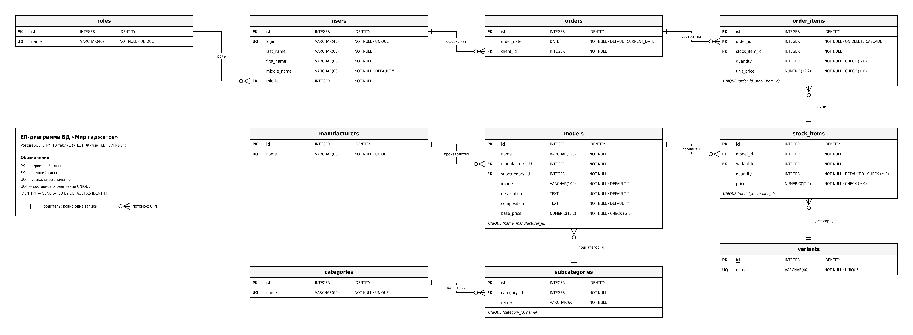

# Мир гаджетов — база данных и приложение для автоматизации продаж

Учебный проект по УП.11 «Разработка, администрирование и защита баз данных» (ПМ.11), тема 8.
Студент: Жилин Павел Витальевич, группа 3ИП-1-24.

Приложение для продажи персональной электроники: каталог моделей (смартфоны, планшеты, умные часы,
портативные аккумуляторы), корзина, оформление и управление заказами. База данных — **PostgreSQL**,
приложение — **Python + Tkinter**.

## Возможности

- **Каталог.** Карточки моделей: изображение (если его нет — `picture.png`), категория, производство,
  описание, состав, цена «от» (минимальная цена вариантов), варианты (цвет корпуса) и остатки в штуках.
- **Окно модели.** Клик по карточке открывает окно с крупным изображением, полным описанием, составом и таблицей
  вариантов (цена и остаток). Здесь же выбирается вариант и количество и модель добавляется в корзину:
  после выбора варианта показываются его цена и доступное количество; при нулевом остатке — «Недоступно для заказа».
- **Подсветка.** Модель с суммарным остатком ≤ 3 (включая 0) выделяется цветом `#ff8080`.
- **Поиск, фильтр и сортировка** (для авторизованных): поиск по наименованию, фильтр категории
  («Все категории»), сортировка по базовой цене. Работают совместно и применяются сразу; сортировка сохраняется.
- **Корзина.** Добавление и удаление позиций, изменение количества, подтверждение заказа. Повторное добавление
  объединяет количество; больше остатка заказать нельзя. Перед сохранением остатки и цены проверяются повторно.
- **Заказы.** Заказ, его строки и изменение остатков сохраняются **атомарно** (одной транзакцией).
  В строке заказа хранится цена на момент оформления — изменение каталога её не меняет.
  Удаление заказа или строки возвращает количество в остаток.
- **Роли и права.**

| Возможность | Гость | Авторизованный пользователь | Менеджер | Администратор |
|---|:--:|:--:|:--:|:--:|
| Просмотр каталога | ✅ | ✅ | ✅ | ✅ |
| Поиск, фильтр, сортировка | — | ✅ | ✅ | ✅ |
| Корзина, оформление своего заказа | — | ✅ | ✅ | ✅ |
| Список заказов и их состав | — | — | ✅ | ✅ |
| Создание заказа для клиента, удаление заказа | — | — | ✅ | ✅ |
| Изменение даты заказа, удаление строк | — | — | — | ✅ |

Вход — только по логину (без пароля). Ошибки объясняются пользователю диалогами и не завершают приложение;
перед удалением всегда запрашивается подтверждение, отмена данных не меняет.

Тестовые логины: `admin` (администратор), `manager1`, `manager2` (менеджеры), `client01` … `client17` (клиенты).

## Запуск

1. Установить **PostgreSQL 13+** и **Python 3.9+** (с Tkinter).
2. Создать базу и загрузить схему с данными:
   ```bash
   psql -U postgres -c "CREATE DATABASE gadgets_db ENCODING 'UTF8'"
   psql -U postgres -d gadgets_db -f src/db/mir_gadgetov.sql
   ```
   (pgAdmin: создать БД `gadgets_db` → Query Tool → открыть `src/db/mir_gadgetov.sql` → F5.)
3. Установить зависимости: `pip install -r requirements.txt`
4. При необходимости задать параметры подключения (по умолчанию `localhost:5432`, БД `gadgets_db`,
   пользователь `postgres`, пароль `postgres`) — переменными окружения или в `src/app/config.py`:
   ```bash
   set PGPASSWORD=ваш_пароль          # Windows (cmd)
   export PGPASSWORD=ваш_пароль       # Linux / macOS
   ```
5. Запустить: `python src/app/main.py`

Необязательно (защита данных): `psql -U postgres -d gadgets_db -f src/db/security.sql` создаёт учётную запись
`gadgets_app` с минимальными правами; затем запустите приложение с `PGUSER=gadgets_app`.

## База данных

PostgreSQL, 3НФ, 10 таблиц: `roles`, `users`, `categories`, `subcategories`, `manufacturers`, `variants`,
`models`, `stock_items`, `orders`, `order_items`. Заданы `PRIMARY KEY`, `FOREIGN KEY`, `UNIQUE`, `NOT NULL`,
`DEFAULT`, `CHECK`; индексы по внешним ключам; представления `v_catalog` и `v_order_totals`.



- ER-диаграмма: [`docs/ERD_mir_gadgetov.pdf`](docs/ERD_mir_gadgetov.pdf) (редактируемая: `docs/ERD_mir_gadgetov.drawio`)
- Схема алгоритма: [`docs/algorithm_mir_gadgetov.pdf`](docs/algorithm_mir_gadgetov.pdf)
- Скрипт БД со схемой и данными: [`src/db/mir_gadgetov.sql`](src/db/mir_gadgetov.sql)
- `src/db/mir_gadgetov.db` — SQLite-копия тех же данных для просмотра (например, в DB Browser);
  приложение работает с PostgreSQL.
- Скрипт `src/db/generate_sql.py` строит `mir_gadgetov.sql` и `.db` из таблиц `docs-import/*.xlsx`
  и проверяет целостность (уникальность ключей, связи, цены, изображения). Остатки в импорте уже учитывают
  исходные заказы и повторно не списываются.

## Структура репозитория

```
up11-project-zhilin/
├── README.md
├── requirements.txt
├── docs/
│   ├── ERD_mir_gadgetov.pdf  (+ .png, .drawio)
│   ├── algorithm_mir_gadgetov.pdf
│   └── screenshots/              скриншоты работы приложения
├── src/
│   ├── db/
│   │   ├── mir_gadgetov.sql      схема + данные (PostgreSQL)
│   │   ├── mir_gadgetov.db       SQLite-копия данных
│   │   ├── security.sql          права учётной записи приложения
│   │   └── generate_sql.py       импорт из XLSX
│   ├── app/
│   │   ├── main.py               запуск, навигация
│   │   ├── config.py, db.py      настройки и подключение
│   │   ├── auth_service.py, catalog_service.py, order_service.py   логика и запросы
│   │   ├── cart.py, permissions.py, models.py, styles.py, dialogs.py
│   │   └── ui_*.py               формы: вход, каталог, окно модели, корзина, заказы, состав, добавление заказа
│   └── resources/                logo.png, icon.ico, picture.png, Images/
└── docs-import/                  Products, Variants, Stock_Items, Orders, Users (XLSX)
```

Вместо `Sizes_import.xlsx` обувного примера в этой теме используется `Variants_import.xlsx` (цвет корпуса).

## Скриншоты

Скриншоты работы приложения находятся в [`docs/screenshots/`](docs/screenshots/).
